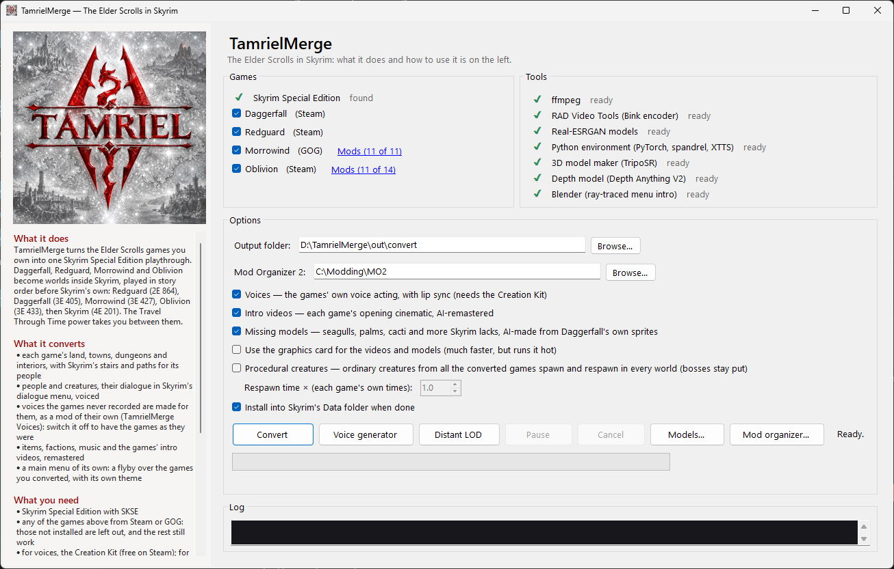
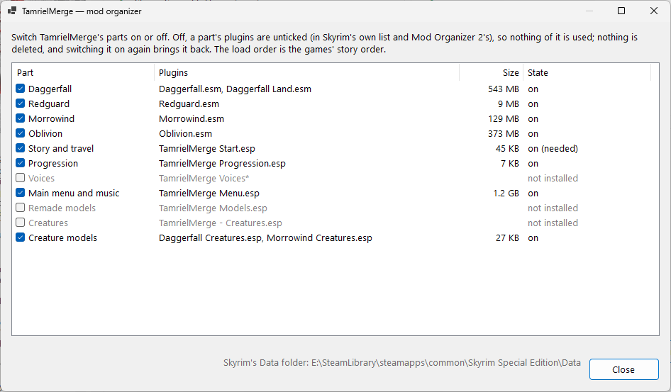
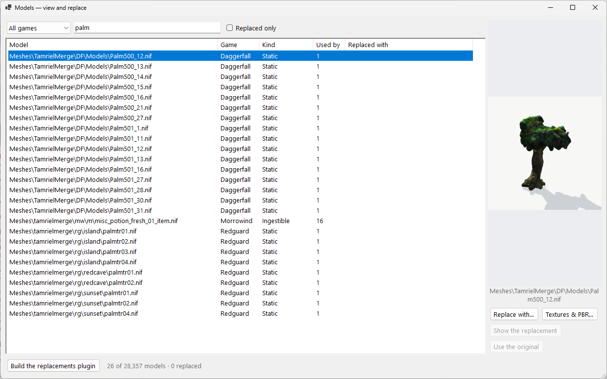

# TamrielMerge

https://www.nexusmods.com/skyrimspecialedition/mods/195263

p.s this has nothing to do with tes4skyrim, tesconverter, skygerfall, skyblivion, skywind or any other converter. this was all me with ai

**The Elder Scrolls games you own, as one Skyrim Special Edition playthrough.**

TamrielMerge converts Daggerfall, Redguard, Morrowind and Oblivion into Skyrim Special Edition. Each becomes a world
inside Skyrim, played in story order before Skyrim's own: Redguard (2E 864), Daggerfall (3E 405), Morrowind (3E 427),
Oblivion (3E 433), then Skyrim (4E 201). The Travel Through Time power takes you between them.

Everything is built on your own machine from your own copies of the games (Steam or GOG). Their folders are only read,
never changed.

## Screenshots

### The app



The main window. On the left, what the tool does and how to use it. On the right:

- **Games**: the Elder Scrolls games found in your Steam and GOG libraries. Tick the ones to convert; games you don't
  own are simply left out. *Mods* lets you choose which of a game's own mods are converted with it.
- **Tools**: everything the conversion needs (ffmpeg, the Bink encoder, the upscaling and 3D models, Python, Blender
  and so on), each marked ready or missing. *Install missing tools* fetches what's missing.
- **Options**: the output folder, your Mod Organizer 2 folder, and what to make: voices, remastered intro videos,
  models for Daggerfall's sprites, procedural creatures, and whether to install into Skyrim's Data folder when done.
- **Convert** runs the whole conversion, with progress, time left and a log. **Voice generator** speaks the lines
  the games never recorded. **Distant LOD** remakes the converted worlds' distant view (land, buildings, trees).
  **Pause** and **Cancel** hold or stop a run.

### Mod organizer



Switches TamrielMerge's parts on or off: each game, the story and travel plugin, progression, the voices, the main
menu and music, remade models and creatures. Off, a part's plugins are unticked in Skyrim's own plugin list and in
Mod Organizer 2's, so nothing of it is used; nothing is deleted, and switching it on brings it back. The load order is
the games' story order, and a part is never left on without the parts it needs.

### Models



Every model the converted games use (28,357 here), searchable by name, game and kind, with a turning preview of the
selected one. Here, one of the palm trees made from Daggerfall's own sprites. *Replace with…* swaps a model for any
other from any of your games; *Textures & PBR…* changes its textures and makes normal and specular maps;
*Build the replacements plugin* applies your choices as their own plugin.

## What it converts

- Each game's land, towns, dungeons and interiors, with Skyrim's stairs and paths for its people. Daggerfall's Iliac
  Bay is one seamless overland at its own scale, with its towns, its 4,228 dungeons and its grass and ground.
- People and creatures, with their dialogue in Skyrim's dialogue menu, voiced: the games' own recordings, and the
  lines they never recorded spoken in Skyrim's voices (as a mod of their own you can switch off).
- Items, factions, guilds, skills, spells, music and each game's intro video, remastered.
- Morrowind's scripts, all of them: its quests, scripted doors, items, activators and people, its global scripts and
  its dialogue's results, translated into Skyrim's script language (docs/morrowind-scripts.md).
- Daggerfall's travel: days on the road to a town, seen in real time, with encounters, sea voyages and the era of
  each destination.
- Alternative starts: begin with the stories in order, or in any game's time you own, after its opening or with it.
- Models for Daggerfall's sprites that Skyrim has nothing like (palms, cacti, seagulls...), made by AI from the
  sprites themselves, and creatures with skeletons and animations of their own.
- A main menu of its own: a flyby over the games you converted, with an original theme.
- The converted worlds' distant view: land, buildings, rocks and trees.

## What you need

- **Windows 10 or 11, 64-bit.**
- **Skyrim Special Edition** (Steam or GOG) with **[SKSE](https://skse.silverlock.org/)** and **Address Library
  for SKSE Plugins**.
- **Any of the games to convert**, from Steam or GOG: The Elder Scrolls II: Daggerfall, An Elder Scrolls Legend:
  Redguard, The Elder Scrolls III: Morrowind, The Elder Scrolls IV: Oblivion. Those not installed are left out and
  the rest still work.
- **For voices and lip sync**: the Skyrim Special Edition Creation Kit (free on Steam, under Library > Tools). Start it
  once after installing so it unpacks its tools.
- **Disk space**: about 60 GB while converting all four games. The build is made on a solid-state drive when the
  output folder is on a hard disk, keeping 32 GB free on the Windows drive.
- **A graphics card** (NVIDIA recommended) for the remastered videos, the models and the voice generator. They work on
  the processor too, much more slowly.

## Install

1. Download `TamrielMerge-<version>-win-x64.zip` from the [latest release](../../releases/latest).
2. Unzip it into a folder of its own, on a drive with room (for example `D:\TamrielMerge`). Not inside Skyrim's
   folder or `Program Files`.
3. Run **`TamrielMerge.exe`**. It needs the [.NET 10 Desktop Runtime](https://dotnet.microsoft.com/download/dotnet/10.0)
   (Windows offers to install it the first time if it's missing).
4. Click **Install missing tools**. It downloads what the conversion needs into the app's `tools` folder: ffmpeg, the
   Bink encoder, the upscaling and AI models, Python environments, Blender, FFDec, and Java if you don't have it.
   That's several gigabytes, and it only happens once.
5. If the Creation Kit is missing, click **Open the Creation Kit in Steam** and install it (for voices).

## Use

1. Tick the games to convert and choose the options. Leave *Use the graphics card* off unless you want the videos
   and models made faster; it keeps the card under load for hours.
2. Set the **output folder** (where the plugins and files go) and, if you use it, your **Mod Organizer 2** folder.
3. Click **Convert**. A full conversion takes hours (Daggerfall's 3,400 towns and 4,200 dungeons are most of it). You
   can pause it at any time. A stopped conversion can be carried on from where it stopped with
   `TamrielMerge.Cli.exe convert --resume` (the same options as before).
4. With *Install* ticked, the result goes into Skyrim's Data folder and its plugins are switched on, in Skyrim's own
   plugin list and in your Mod Organizer 2 profile. Its meshes, textures and scripts go in compressed archives (BSA),
   its sounds and voices in plain ones, each game's named after its plugin, so Data holds a few archives instead of
   hundreds of thousands of loose files. Installing also clears out what an earlier install left that this one doesn't
   have: older loose copies (loose files would win over the new archives), stale files in TamrielMerge's own folders,
   and plugins it no longer makes, which also come off the plugin lists. The output folder keeps its loose files.
   Otherwise copy the output folder into Data yourself, or add it to your mod manager as a mod.
5. Start a **new game** in Skyrim. The first story begins with its intro, which you can watch or skip.

Optional:

- **Voice generator** speaks Morrowind's unrecorded dialogue, and the lines Oblivion never recorded, in Skyrim's
  voices. It runs for a long time; pause it
  whenever you like, and it resumes where it stopped.
- **Distant LOD** remakes the distant view of the converted worlds after you change something.
- **Models…** and **Mod organizer…** as above.

## Command line

The app runs `TamrielMerge.Cli.exe`, which can be used on its own:

```
TamrielMerge.Cli.exe setup                    install the tools the conversion needs
TamrielMerge.Cli.exe convert [--out DIR] [--install] [--gpu] [--skip Morrowind,Voices,...] [--resume] [--no-staging]
TamrielMerge.Cli.exe lod --dir DIR [--only terrain,objects,trees] [--install]
TamrielMerge.Cli.exe install [--dir DIR]       install a finished conversion into Skyrim's Data folder
TamrielMerge.Cli.exe voices --out DIR [--gpu]
TamrielMerge.Cli.exe drives                   where a conversion would be built
```

## Build from source

Needs the [.NET 10 SDK](https://dotnet.microsoft.com/download).

```
git clone https://github.com/Murray2k6/TamrielMerge.git
cd TamrielMerge
dotnet build src/TamrielMerge.Gui -c Release -o out/gui
out\gui\TamrielMerge.exe
```

The repository holds the source, scripts and documents. What the tool downloads (`setup`) and what it makes from your
games aren't in it. The models made from Daggerfall's sprites come with the release; from source, the conversion's
*Missing models* step makes them (AI, on the graphics card). The SKSE plugins' sources are in `tools/skse`, built
already, and rebuilt with their `build.ps1` (Visual Studio's C++ tools): TamrielMergeEra (the era in the game's dates)
and TamrielMergeSeamless (Skyrim's physics area widened for Daggerfall's one-worldspace overland).

## Documentation

How each part works, in `docs/`:

| | |
|---|---|
| [building.md](docs/building.md) | where a conversion is built, resuming, plugin size, using the cores |
| [game-systems.md](docs/game-systems.md) | the games' systems in Skyrim: grass, ground, scale, travel |
| [travel.md](docs/travel.md) | Daggerfall's travel in every converted world |
| [progression.md](docs/progression.md) | how the game begins, factions, skills and the Tamriel menu |
| [distant-lod.md](docs/distant-lod.md) | the distant view: land, objects and trees |
| [sprite-models.md](docs/sprite-models.md) | models made from Daggerfall's sprites |
| [creatures.md](docs/creatures.md) | creatures with their own skeletons and animations |
| [models.md](docs/models.md) | the model viewer and replacements |
| [voices.md](docs/voices.md) | recorded and generated voices |
| [videos.md](docs/videos.md) | the remastered intro videos |
| [menu.md](docs/menu.md) | the main menu flyby and theme |
| [parts.md](docs/parts.md) | the mod organizer |
| [daggerfall-quests.md](docs/daggerfall-quests.md), [daggerfall-talk-reputation.md](docs/daggerfall-talk-reputation.md) | Daggerfall's quests, conversation and reputation |

## Credits and licences

TamrielMerge is free software under the **GNU General Public License v3.0** ([LICENSE](LICENSE)).

It is a fan project, not made or endorsed by Bethesda Softworks or ZeniMax Media. The Elder Scrolls, Daggerfall,
Redguard, Morrowind, Oblivion and Skyrim are their trademarks. You need your own copies of the games.

Built with:

- [Mutagen](https://github.com/Mutagen-Modding/Mutagen) (GPL-3.0): reading and writing Bethesda plugins.
- [nifly / niflysharp](https://github.com/ousnius/nifly) (GPL-3.0): NIF meshes.
- [DotRecast](https://github.com/ikpil/DotRecast) (zlib): navmeshes.
- [K4os.Compression.LZ4](https://github.com/MiloszKrajewski/K4os.Compression.LZ4) (MIT): compressing the installed
  archives.
- [HKX2Library](https://github.com/krenyy/HKX2Library) (MIT), in `src/ThirdParty`: Havok skeletons and animations.
- [TripoSR](https://github.com/VAST-AI-Research/TripoSR) (MIT), in `tools/model3d/TripoSR`: models from sprites.
- [Real-ESRGAN](https://github.com/xinntao/Real-ESRGAN) (BSD-3-Clause): upscaling, its models downloaded by setup.
- [Coqui TTS / XTTS-v2](https://github.com/idiap/coqui-ai-TTS): voices, downloaded by setup (XTTS-v2's model is under
  the Coqui Public Model License).
- [Depth Anything V2](https://github.com/DepthAnything/Depth-Anything-V2), [DeepBump](https://github.com/HugoTini/DeepBump)
  (GPL-3.0), [FFDec](https://github.com/jindrapetrik/jpexs-decompiler) (GPL-3.0), [FluidSynth](https://www.fluidsynth.org/)
  (LGPL-2.1), [GeneralUser GS](https://schristiancollins.com/generaluser.php), [Blender](https://www.blender.org/),
  [ffmpeg](https://ffmpeg.org/), [RAD Video Tools](https://www.radgametools.com/bnkdown.htm),
  [Eclipse Temurin](https://adoptium.net/), [WildMIDI](https://github.com/Mindwerks/wildmidi) (LGPL-3.0),
  [Crash Logger SSE](https://github.com/alandtse/CrashLoggerSSE) (MIT, for the game check): downloaded or used by setup.
- Creature models: see [tools/creatures/CREDITS.md](tools/creatures/CREDITS.md) (CC0, CC-BY 3.0/4.0, CC-BY-SA 3.0).
- The ship: a free model from [CGTrader](https://www.cgtrader.com/free-3d-models/watercraft/historic-watercraft/ship-8d79bbda-ccc3-45f9-8b38-ec81c5a4d0cd).
- [SKSE](https://skse.silverlock.org/) runs the plugins; they read [Address Library for SKSE Plugins](https://www.nexusmods.com/skyrimspecialedition/mods/32444).

The converters are this project's own code. These projects were the references for how the games work (their
behaviour and file formats followed, their code not included):

- [Daggerfall Unity](https://github.com/Interkarma/daggerfall-unity) (MIT), by Gavin Clayton (Interkarma) and its
  contributors: the reference for Daggerfall throughout. Its readers' layouts for ARENA2's files (BSA archives, the
  world map and climates, blocks, models, textures, flats, factions, names, text, books, spells, creatures, quests),
  its terrain generation and ground tiles, town and dungeon layouts, the rules of Daggerfall's actions, locks, traps,
  enemy senses and spawning, the quest engine (its task rules and commands, QuestListsManager's offers), reputation,
  guilds, shops, holidays and taverns, and the songs' playlists (SongManager).
- The [Dynamic Music](https://www.nexusmods.com/daggerfallunity/) mod for Daggerfall Unity: the combat playlist.
- [RGUnity](https://github.com/RGUnity) (MIT) and the redguard-preservation notes: Redguard's models, scenes and scripts.
- [OpenMW](https://openmw.org/) (GPL-3.0) and the [NifTools](https://github.com/niftools/nifxml) nif.xml: Morrowind's
  NIF format, its attributes and other formulas.
- [xOBSE](https://github.com/llde/xOBSE): the list of OBSE's script commands, read from its source.
- [UESP](https://en.uesp.net/) (CC BY-SA 2.5): the games' mechanics and Daggerfall's quest codes, for research.
